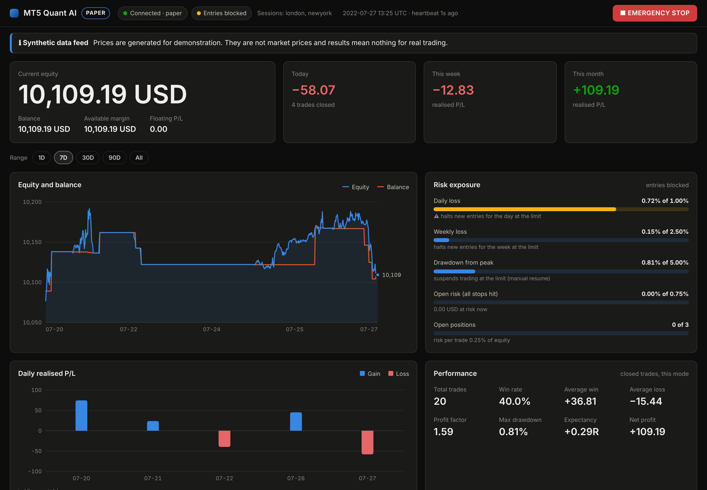

# MT5 Quant AI

A modular, autonomous trading platform for MetaTrader 5: multi-timeframe
analysis, nine independent strategies, an AI-assisted selection layer, strict
risk management, a validation pipeline that is built to reject overfit
strategies, and a dark monitoring dashboard with an emergency stop.

**It ships in PAPER mode. Real-money execution is locked** behind a
multi-key gate and a demo track record (see [docs/LIVE_TRADING.md](docs/LIVE_TRADING.md)).

> No strategy in this repository is claimed to be profitable. Profitability has
> to be demonstrated on your broker's data by the validation pipeline, then on a
> demo account. Trading leveraged products can lose money quickly.



*Dashboard in paper mode. The data in this screenshot comes from the built-in
synthetic feed, as the banner on the page states.*

## Current state in one paragraph

The whole platform is implemented and covered by 301 automated tests, and the
engine, dashboard and emergency stop were exercised end-to-end in paper mode.
The MetaTrader 5 adapter is tested against a stand-in for the MT5 API only -
it has **not yet been run against a real terminal** - and every backtest so
far used synthetic prices, so **no strategy is validated**. See
[docs/STATUS.md](docs/STATUS.md) for the exact boundary between tested and
untested.

## What it does

- **Autonomous engine** - monitors the configured symbols during their trading
  sessions, evaluates every freshly closed bar, decides, sizes, executes and
  manages positions on its own, and stays out when conditions are unfavourable.
- **Analysis** - RSI, MACD, EMA 9/20/50/100/200, SMA, Bollinger, ATR, ADX,
  VWAP, Fibonacci, support/resistance, market structure (HH/HL, BOS, CHoCH),
  breakouts/false breakouts, liquidity sweeps, supply/demand, fair value gaps,
  order blocks, volume, candlestick patterns - all strictly causal.
- **Multi-timeframe** - M1 to W1; higher-timeframe context is aligned without
  look-ahead; conflicting signals are detected; every setup gets a confidence
  score.
- **Strategies** - scalping, intraday, trend following, breakout, mean
  reversion, momentum, liquidity sweep, Smart Money Concepts, volatility. A
  selector matches strategies to the current regime. No setup, no trade.
- **AI engine** - regime classification, volatility/spread anomaly detection,
  an ML meta-model with purged walk-forward validation, live performance
  degradation detection, recurring-pattern research with false-discovery
  control, and plain-language explanations of every decision.
- **News** - economic-calendar providers, tier-1 event detection, entry
  blackouts, pre-news size reduction, manual blackouts, fail-closed when the
  calendar is unavailable.
- **Risk** - 0.25% risk per trade, 1% daily loss, 2.5% weekly loss, 5% drawdown
  suspension, position/correlation/open-risk limits, spread, slippage and
  margin protection, emergency shutdown. No martingale, no grid, no averaging
  down. Limits are configurable only inside hard-coded ceilings.
- **MetaTrader 5** - account, quotes, history, symbol specs, market and pending
  orders, SL/TP modification, closing, rejection handling, safe reconnect;
  direct on Windows or through an authenticated gateway.
- **Backtesting** - spreads, commission, slippage, execution delay, swap;
  out-of-sample and walk-forward testing, Monte Carlo, parameter sensitivity,
  cost stress, deflated Sharpe.
- **Operations** - dashboard, notifications, heartbeat and watchdog, daily
  reports, audit log, crash recovery, duplicate-order prevention.

## Quick start

```bash
python -m venv .venv && source .venv/bin/activate      # Windows: .venv\Scripts\activate
pip install -r requirements.txt

python main.py check                                    # environment + configuration diagnostics
python -m pytest                                        # full test-suite

# Paper trading on the built-in SYNTHETIC feed (not market prices) + dashboard
python main.py run                                      # http://127.0.0.1:8050

# Backtest / validate (use broker history; --synthetic only exercises the pipeline)
python main.py backtest --data EURUSD=data/EURUSD_M5.csv
python main.py validate --data EURUSD=data/EURUSD_M5.csv GBPUSD=data/GBPUSD_M5.csv --verbose
python main.py backtest --synthetic 100000 --symbols EURUSD

python main.py status                                   # health + risk state
python main.py stop "reason"                            # EMERGENCY STOP
python main.py resume --confirm                         # manual resume
```

To connect a MetaTrader 5 **demo** account see [docs/DEPLOYMENT.md](docs/DEPLOYMENT.md).

## Platform note (MetaTrader 5 and macOS/Linux)

The official `MetaTrader5` Python package exists for **Windows only** and needs
a locally running terminal. This project does not pretend otherwise:

- on Windows the engine talks to the terminal directly (`broker_backend: mt5`);
- on macOS/Linux the engine talks to a small gateway that runs next to the
  terminal on a Windows desktop or VPS (`broker_backend: bridge`), over
  HMAC-signed requests through an SSH/WireGuard tunnel.

`python main.py check` states which case applies on the current machine.

## Configuration and secrets

- `config/default.yaml` - every non-secret setting, documented inline.
- `config/local.yaml` - your overrides (git-ignored).
- `.env` - secrets only (git-ignored). Template: `.env.example`.

The default symbols (`EURUSD`, `GBPUSD`, `USDJPY`) are placeholders for the
simulator. For demo/live they must be the exact names in your broker's Market
Watch; the engine refuses to start on an unknown symbol.

## Risk limits

| Limit | Default | Hard ceiling |
|---|---:|---:|
| Risk per trade | 0.25% | 1% |
| Max daily loss | 1% | 3% |
| Max weekly loss | 2.5% | 6% |
| Max drawdown (suspension) | 5% | 10% |
| Open positions | 3 | 10 |
| Total open risk | 0.75% | 3% |
| Net risk per currency | 0.5% | 2% |
| Trades per day | 10 | 40 |
| Spread / ATR | 15% | 50% |
| Slippage tolerance | 20 points | 100 points |

A config that removes a limit, zeroes it or exceeds its ceiling is rejected
and the engine does not start. Ceilings live in
`mt5quant/risk_management/limits.py` and can only change through a code edit.

## Documentation

- [docs/ARCHITECTURE.md](docs/ARCHITECTURE.md) - layout, data flow, technical choices, limitations
- [docs/STRATEGIES.md](docs/STRATEGIES.md) - hypotheses, selection, validation gates
- [docs/DEPLOYMENT.md](docs/DEPLOYMENT.md) - Windows / bridge setup, autostart, security, monitoring
- [docs/LIVE_TRADING.md](docs/LIVE_TRADING.md) - the path from paper to live and the gate
- [docs/STATUS.md](docs/STATUS.md) - what has been tested, how, and what has not

## Disclaimer

This software is provided for research and educational purposes. It is not
financial advice. You are responsible for every order placed with it.
